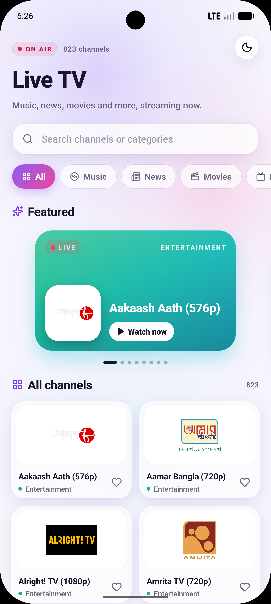

# 📺 Live Streaming App. 
This is a React Native application that streams live with support for volume and brightness gestures, full-screen landscape video playback, and categorized filtering.

## 🛠 Setup
Requires Node 22.11+ and React Native 0.84 tooling (Xcode 16+, Android SDK 36).

```sh
npm install
cp channels.example.js channels.js   # then add your channels (git-ignored)
cd ios && bundle exec pod install && cd ..
npm run ios      # or: npm run android
```

Plain `http://` streams must be allowed per host in
`android/app/src/main/res/xml/network_security_config.xml` and `ios/TvChannel/Info.plist`.

## 🧱 Project structure
```
src/
  theme/tokens.js        colors, type, spacing, motion
  data/channels.js       channel list, categories, filtering
  db/favorites.js        favorites in SQLite (op-sqlite)
  hooks/useFavorites.js  favorites state
  components/            aurora background, search, chips, cards, carousel, icons
  screens/HomeScreen.js  home screen
  player/PlayerModal.js  fullscreen player with gestures
```

## 🚲 Future Enhancements (Suggestions)
* Chromecast or AirPlay support
* Background audio playback
* Program guide (EPG)

---
## 📦 Download For Android : [⬇️ Download](assets/stream.apk)
> ⚠️ Make sure to allow installs from unknown sources on your Android device.

---
## 📷 Screenshots

---

## 🚀 Features
* 🔍 **Search & Filter Channels**
  Quickly find channels by name or category (Music, News, Movies, Religious, etc.).
* 🎥 **Live Video Streaming**
  Streams live video from channel URLs.
* 📱 **Full-Screen Landscape Video Mode**
  Automatically switches to landscape when playing a video.
* 🌕 **Volume & Brightness Control**
  Vertical swipe gestures on the left and right of the screen control brightness and volume, respectively.
* ❤️ **Favorites**
  Saved on the device and shown in a 3D carousel at the top of the home screen.
* ⏭ **Channel switching**
  Previous/next buttons in the player, plus play/pause and mute.
* ❌ **Exit Video Easily**
  Close the video modal with a single tap.


## 📄 License & Privacy Policy
project is under the MIT License.  
See the [LICENSE](LICENSE.txt) file for details.  
See the [PRIVACY](PRIVACY.md) file for details. 

## 🙇‍♂️ Contributing  
We welcome contributions to enhance the project.

## 💰 Support this project. 
If you find this project useful, Give A Star 🌟
